# HDFS — Student Records

Load a student record list into HDFS and query it. **Set up and verified working on this Mac.**

## Files
| File | Purpose |
|---|---|
| `students.csv` | 15 records — `usn,name,branch,semester,cgpa,city` |
| `hadoop-daemons.sh` | `start` / `stop` / `status` the HDFS daemons |
| `hdfs-records.sh` | mkdir → put → ls → cat → count → filters → fsck |
| `mapper.py` / `reducer.py` | Hadoop Streaming: emit `branch\tcgpa` → average per branch |
| `mapreduce-avg-cgpa.sh` | run the streaming job, output to `/user/<you>/students/avg_cgpa_out` |
| `mapper_topper.py` / `reducer_topper.py` | Hadoop Streaming: highest-CGPA student per branch |
| `mapreduce-topper.sh` | run that job, output to `/user/<you>/students/topper_out` |
| `hdfs-admin.sh` | HDFS feature tour: `df`/`du`, `setrep`, `appendToFile`, `get`, `checksum`, snapshots, trash |

## What got installed / configured

- `brew install hadoop` → Hadoop 3.5.0 at `/opt/homebrew/opt/hadoop`
- JDK: `openjdk@17` (Homebrew) — Hadoop 3.x does not run clean on the system Java 26.
  `temurin@17` cask was skipped (needs a GUI `sudo`); the `openjdk@17` bottle works.
- Config edited in `/opt/homebrew/opt/hadoop/libexec/etc/hadoop/`:
  - `core-site.xml` → `fs.defaultFS = hdfs://localhost:9000`, `hadoop.tmp.dir = ~/hadoop-data/tmp`
  - `hdfs-site.xml` → `dfs.replication = 1`
  - `hadoop-env.sh` → `JAVA_HOME` pinned to openjdk@17, `-Djava.security.manager=allow`
- NameNode metadata + DataNode blocks live in `~/hadoop-data/tmp` (survives reboot).
- Daemons started with `hdfs --daemon start ...` directly — no `start-dfs.sh`, so
  **no passwordless SSH / Remote Login needed**.

## Daily use

```bash
./hadoop-daemons.sh start     # NameNode + DataNode
./hdfs-records.sh             # load + query the records
./mapreduce-avg-cgpa.sh      # MapReduce: avg CGPA per branch
./mapreduce-topper.sh        # MapReduce: top student per branch
./hdfs-admin.sh              # HDFS ops: setrep, append, snapshots, trash, checksum
./hadoop-daemons.sh stop      # when done
```

MapReduce runs via the local `LocalJobRunner` (no YARN configured — `mapreduce.framework.name`
is left at its `local` default). Input and output still live in HDFS.

Browse the filesystem in a browser: <http://localhost:9870> → Utilities → Browse the file system → `/user/almaaaann/students`.

## Re-format (only if metadata gets corrupted)

```bash
./hadoop-daemons.sh stop
rm -rf ~/hadoop-data/tmp
export JAVA_HOME=/opt/homebrew/opt/openjdk@17/libexec/openjdk.jdk/Contents/Home
hdfs namenode -format -force
./hadoop-daemons.sh start
```

## Note

`ERROR: Cannot set priority of ... process` on start is cosmetic (renice permission on
macOS) — the daemons still come up. Confirm with `./hadoop-daemons.sh status`.

## Screenshots — every activity

Captured 2026-10-11 from a real run on this Mac. Terminal shots are the actual script
output (`screenshots/logs/*.log`) rendered by `screenshots/render.py`; the cosmetic
`NativeCodeLoader` warning is filtered out and the long per-task MapReduce INFO log is
trimmed (marked in the image). Web UI shots are headless-Chrome captures of `localhost:9870`.

### 1. Start HDFS daemons (NameNode + DataNode)
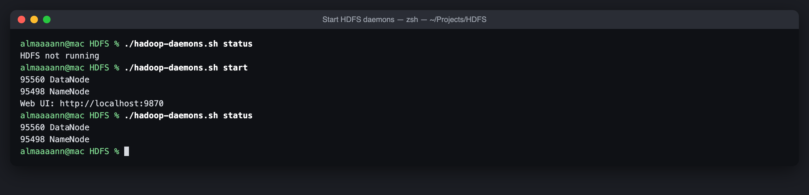

### 2. Wait for NameNode to leave safe mode
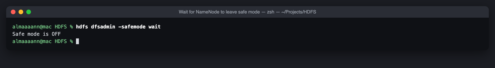

### 3. Load + query records (`hdfs-records.sh`)
| Activity | Screenshot |
|---|---|
| mkdir → put → ls | 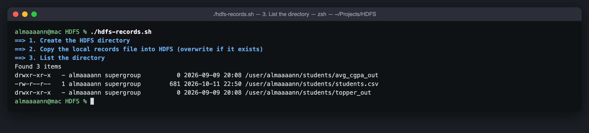 |
| cat full record list from HDFS | 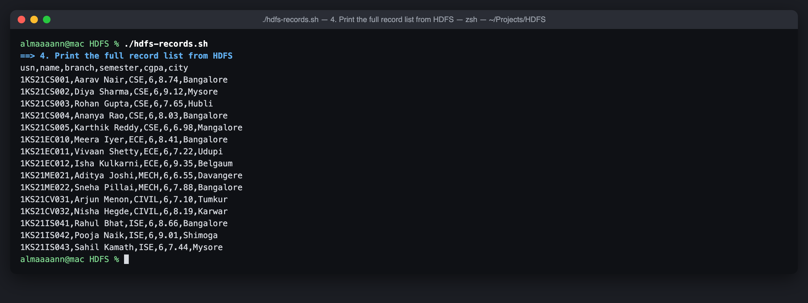 |
| Row count | 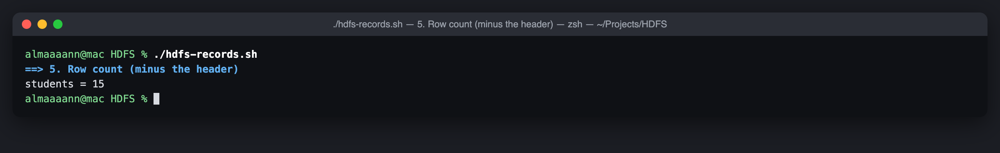 |
| Filter: CSE students | 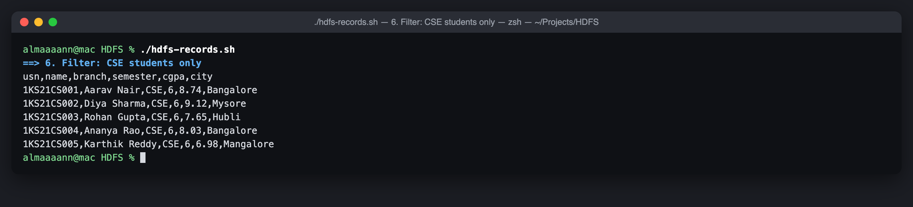 |
| Filter: CGPA ≥ 8.5 | 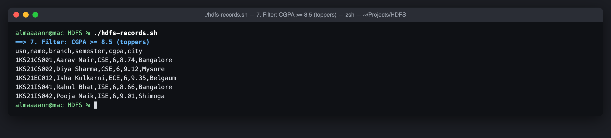 |
| fsck block / replication report | 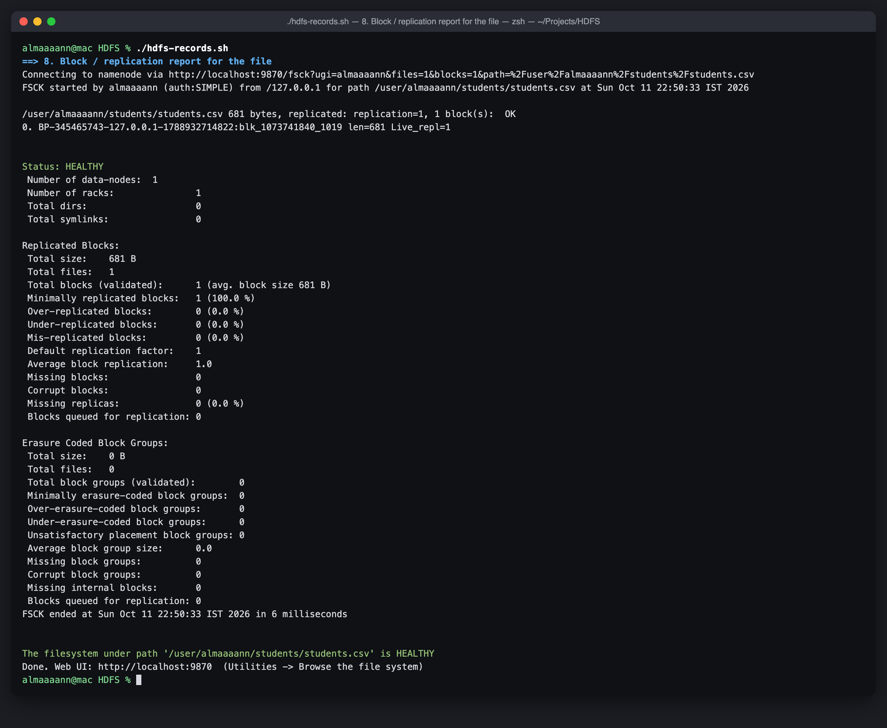 |

### 4. MapReduce — average CGPA per branch
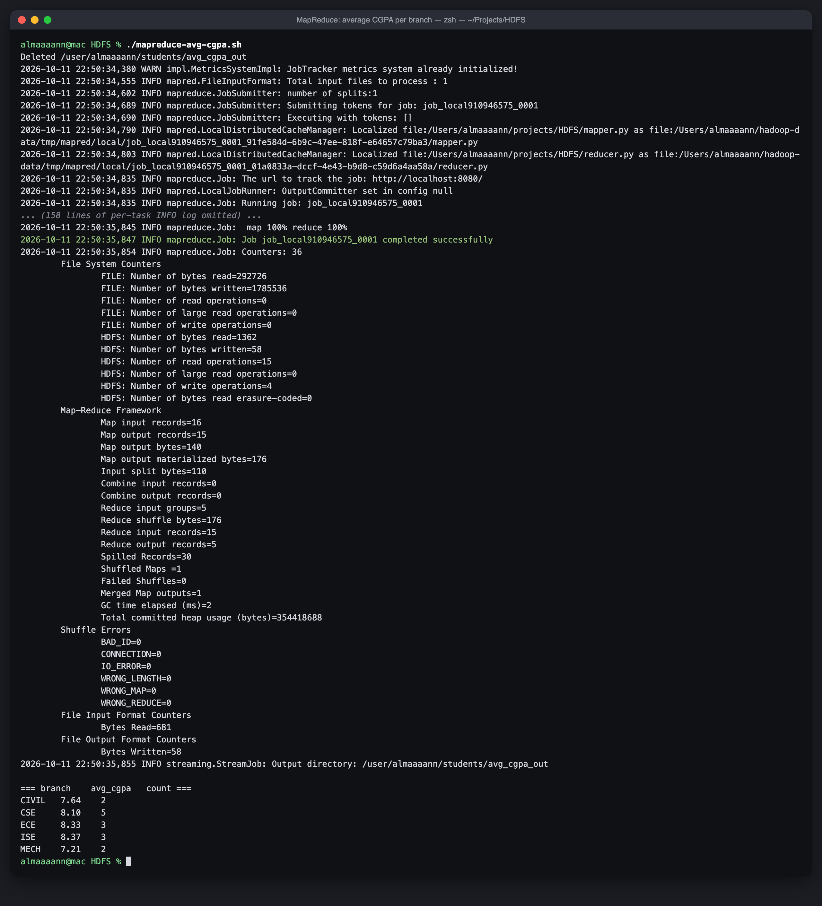

### 5. MapReduce — topper per branch
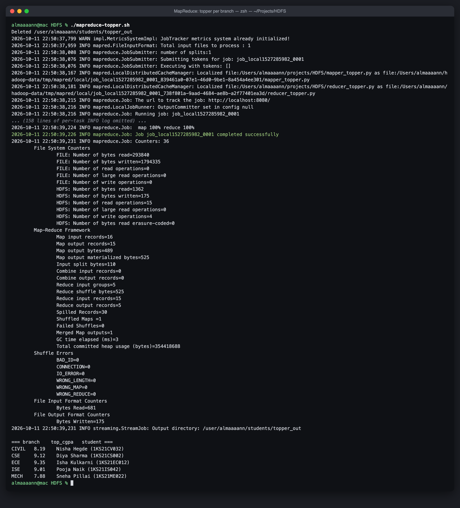

### 6. HDFS admin tour (`hdfs-admin.sh`)
| Activity | Screenshot |
|---|---|
| df / du | 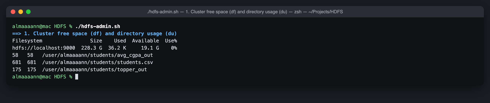 |
| setrep (replication = 2) | 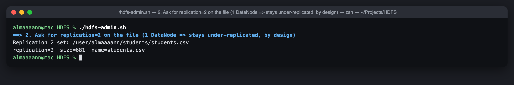 |
| appendToFile (late admission) | 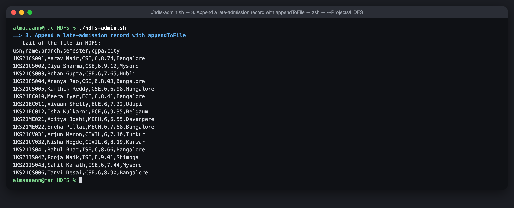 |
| get + diff against local copy | 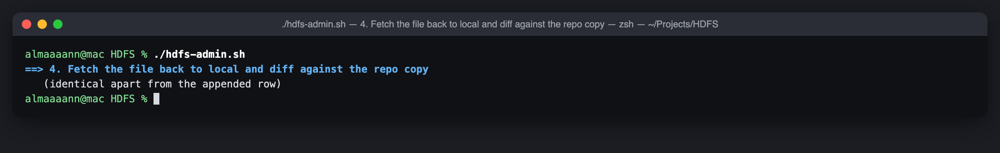 |
| Block checksum | 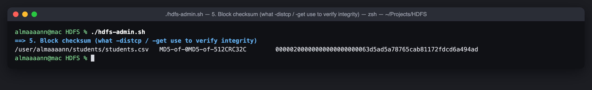 |
| Snapshot → delete → diff → restore | 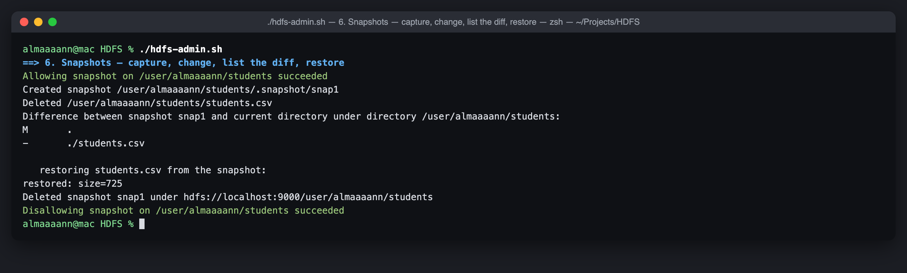 |
| Trash + expunge | 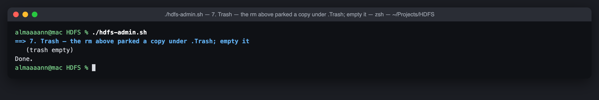 |

### 7. NameNode Web UI
| Page | Screenshot |
|---|---|
| Overview | 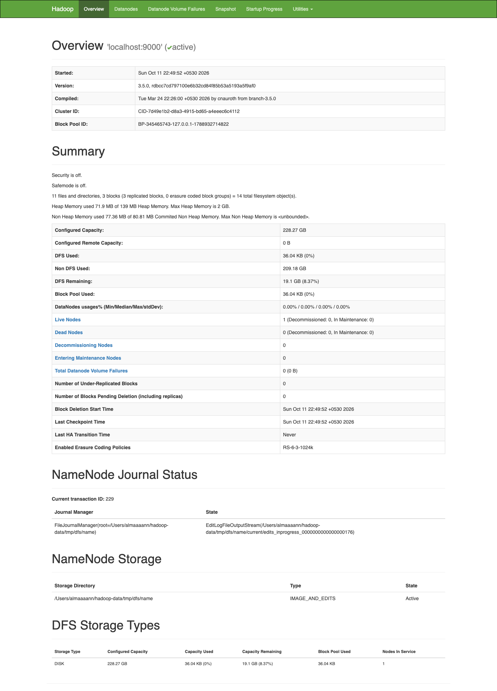 |
| Datanodes | 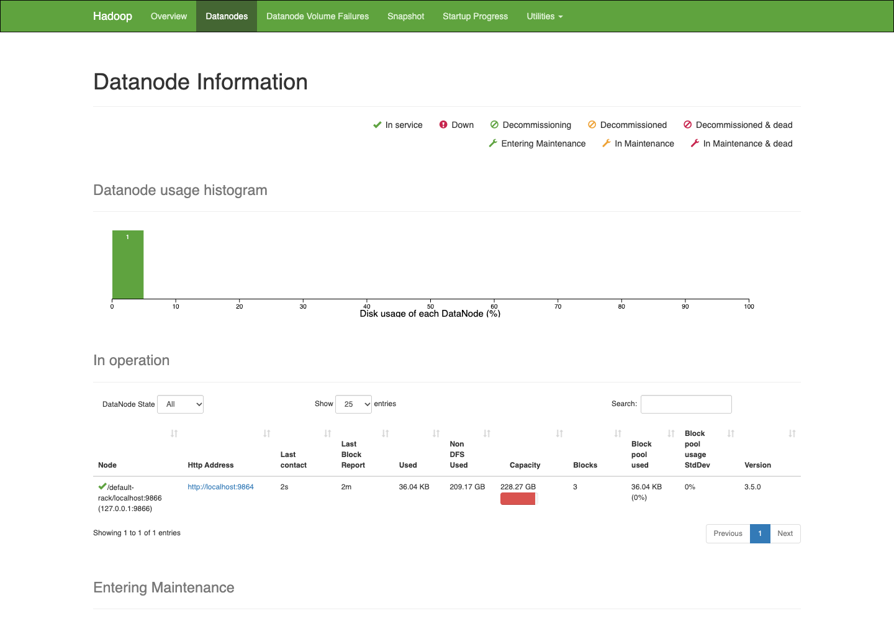 |
| Browse `/user/almaaaann/students` | 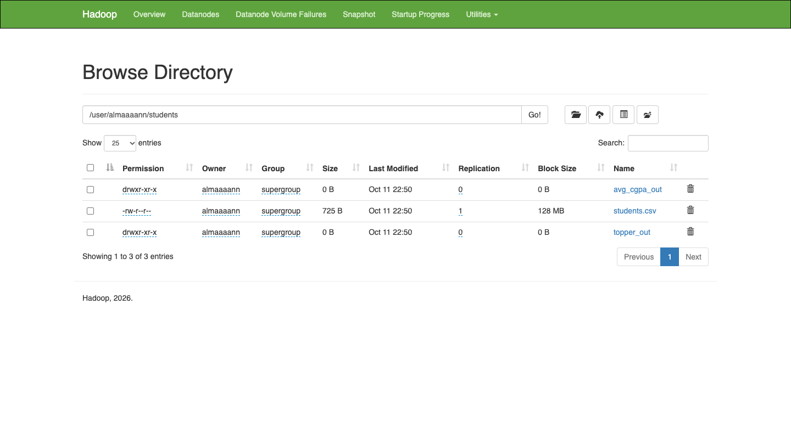 |
| Browse `avg_cgpa_out` | 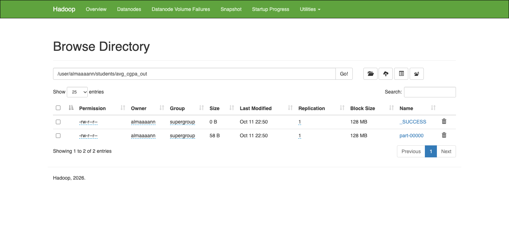 |
| Browse `topper_out` |  |
